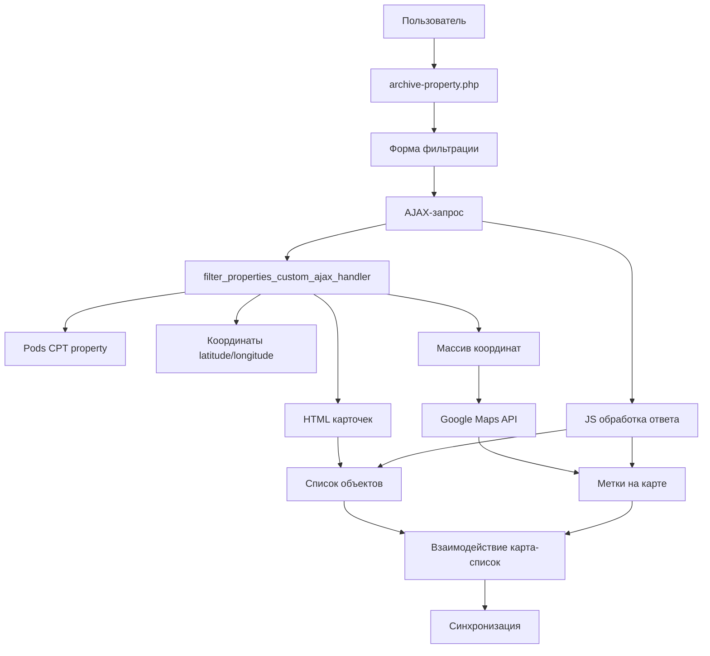

# План интеграции Google Maps на странице архива недвижимости

## 1. Цели интеграции
- Интеграция Google Maps на страницу `/property/`
- Отображение меток всех доступных объектов на карте при загрузке
- Обновление меток на карте при применении фильтров (синхронизация с фильтрами)
- Взаимодействие: клик по метке - информация об объекте; клик по объекту в списке - центрирование карты
- Использование полей `latitude` и `longitude` из CPT `property`
- Адаптивность и корректное отображение на мобильных устройствах

## 2. Архитектурная диаграмма



## 3. Затронутые файлы

### 3.1. PHP-файлы
- `wp-content/themes/realty-theme/inc/frontend/filter-functions.php` - модификация AJAX-обработчика
- `wp-content/themes/realty-theme/archive-property.php` - добавление контейнера для карты
- `wp-content/themes/realty-theme/functions.php` - подключение Google Maps API и нового JS файла

### 3.2. JavaScript-файлы
- `wp-content/themes/realty-theme/js/google-maps-property.js` - новая реализация для Google Maps (вместо Leaflet)
- `wp-content/themes/realty-theme/js/property-filter.js` - возможная модификация для интеграции с Google Maps

### 3.3. CSS-файлы
- `wp-content/themes/realty-theme/archive-property.php` - встроенные стили для карты

## 4. Поток данных

### 4.1. Загрузка страницы
1. Загружается `archive-property.php`
2. Подключаются скрипты Google Maps API и `google-maps-property.js`
3. Инициализируется карта с метками всех доступных объектов

### 4.2. Применение фильтров
1. Пользователь применяет фильтры
2. Отправляется AJAX-запрос к `filter_properties_custom_ajax_handler`
3. Обработчик возвращает:
   - HTML карточек объектов
   - Массив координат объектов
4. JavaScript обновляет:
   - Список объектов
   - Метки на карте

## 5. Технические детали

### 5.1. AJAX-ответ
```json
{
  "success": true,
  "data": {
    "properties_html": "HTML карточек",
    "count": "Количество объектов",
    "coordinates": [
      {
        "id": "ID объекта",
        "lat": "Широта",
        "lng": "Долгота",
        "title": "Название объекта"
      }
    ]
  }
}
```

### 5.2. Синхронизация
- При клике на метку на карте: выделение соответствующей карточки и скролл к ней
- При клике на карточку: центрирование карты на соответствующем объекте

## 6. Потенциальные проблемы и решения

### 6.1. Конфликты с MapPress
- Проблема: плагин MapPress может использовать Google Maps API
- Решение: проверить настройки MapPress и при необходимости отключить на странице архива недвижимости

### 6.2. Производительность при большом количестве меток
- Проблема: большое количество меток может замедлить работу карты
- Решение: реализовать кластеризацию меток

### 6.3. Загрузка Google Maps API
- Проблема: необходимость корректной загрузки API
- Решение: использовать deferred загрузку и проверку наличия API

## 7. Этапы реализации

1. Модификация AJAX-обработчика для возврата координат
2. Создание нового JS файла для логики Google Maps
3. Обновление шаблона archive-property.php
4. Тестирование интеграции
5. Оптимизация (при необходимости)